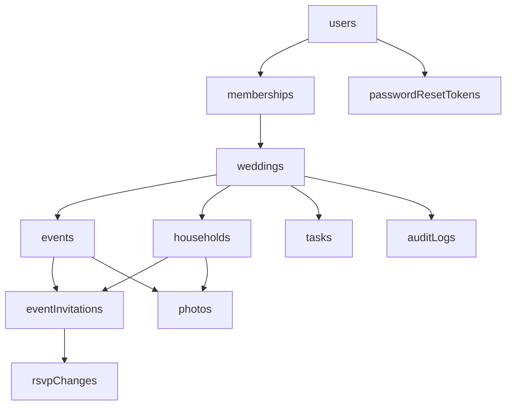
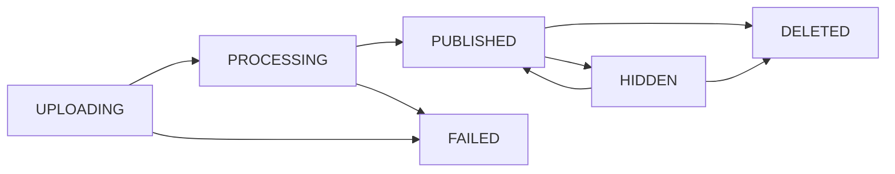

# Make My Marriage — Database Design

## 1. Document status

- **Status:** Draft for review
- **Database:** MongoDB Atlas (free tier to start)
- **Persistence library:** Mongoose
- **Request validation:** Zod
- **Related documents:** `PRD.md`, `SYSTEM_DESIGN.md`, `API_DOCS.md`

This document is the authoritative reference for collections, fields, indexes, and data rules. Where `SYSTEM_DESIGN.md` summarizes the same model, this document wins.

## 2. Design principles

1. **One collection per entity.** No single wedding document that grows with every guest, RSVP, and photo.
2. **`eventInvitations` is the access record.** A household can see an event, its livestream link, and its photo album only if an invitation record links them. The RSVP answer does not affect access.
3. **Every record carries `weddingId`.** There is one wedding today; the field is cheap and keeps a second wedding possible without migration.
4. **Disable or archive instead of deleting** households and events, so RSVP history and photos stay consistent.
5. **No secrets in the database in usable form.** Passwords are hashed, invitation links cannot be rebuilt without a server secret, and reset tokens are hashed.
6. **Keep it inside the free tier.** Total size stays far below 512 MB, and hot paths use few operations because the free tier allows about 100 operations per second.

## 3. Collections overview



- `users` — planner accounts (Admins and Managers). Guests never have user records.
- `memberships` — a planner's role in the wedding.
- `weddings` — wedding details and settings.
- `events` — Haldi, Mehndi, Sangeet, and so on.
- `households` — invited families or groups, with their private-link material.
- `eventInvitations` — one record per household per invited event, holding the current RSVP.
- `rsvpChanges` — write-once history of every RSVP change.
- `tasks` — planning tasks.
- `photos` — photo metadata; the image files live in Cloudflare R2.
- `auditLogs` — record of privileged and destructive actions.
- `passwordResetTokens` — short-lived reset tokens.
- `rateLimits` — short-lived counters for sensitive actions.

## 4. Conventions

### 4.1 Types and naming

- Collection names are camelCase plurals; field names are camelCase.
- `_id` is a MongoDB `ObjectId`. APIs expose it as a string `id`.
- All Mongoose schemas use `timestamps: true`, adding `createdAt` and `updatedAt`.
- All dates are stored in UTC. Display uses the wedding's `timezone` (default `Asia/Kolkata`).
- Enumerated values are uppercase strings.

### 4.2 Shared constants

Enums are defined once in a shared constants module and imported by both the Zod schemas and the Mongoose schemas, so they cannot drift apart:

```text
ROLES              = ADMIN | MANAGER
ACCOUNT_STATUS     = ACTIVE | DISABLED
WEDDING_STATUS     = DRAFT | ACTIVE | ARCHIVED
EVENT_STATUS       = ACTIVE | ARCHIVED
HOUSEHOLD_STATUS   = ACTIVE | DISABLED
DELIVERY_STATUS    = NOT_SENT | SENT
RSVP_RESPONSE      = PENDING | YES | NO | MAYBE
ACTOR_TYPE         = USER | HOUSEHOLD | SYSTEM
TASK_STATUS        = TODO | IN_PROGRESS | DONE
TASK_PRIORITY      = LOW | MEDIUM | HIGH
PHOTO_STATUS       = UPLOADING | PROCESSING | PUBLISHED | HIDDEN | FAILED | DELETED
```

### 4.3 Zod and Mongoose responsibilities

- **Zod** validates every API request body, query, and route parameter before any database call. It also normalizes input (trimming, lowercasing emails, formatting phones).
- **Mongoose** defines stored shape, defaults, enums, required fields, and indexes. It is the last line of defence, not the primary validator.
- API responses are built by explicit mapper functions. Mongoose documents are never returned directly, so fields such as `passwordHash`, `tokenSalt`, and `tokenHash` cannot leak by accident.

### 4.4 Normalization

- **Email:** trimmed and lowercased.
- **Phone:** stored in E.164 format. Ten-digit numbers without a country code are assumed to be Indian and stored as `+91XXXXXXXXXX`.
- **Names and labels:** trimmed, internal whitespace collapsed.
- **Search field:** `searchName` holds lowercase label and contact name for prefix search.

### 4.5 Connection and index management

- One Mongoose connection is cached on `globalThis` and reused across requests in a warm Vercel function instance.
- Models are registered with the `models.Name || model(...)` guard to avoid recompilation during development hot reload.
- `autoIndex` is disabled in production. A setup script runs `syncIndexes()` for every model once per deploy.
- Connection settings: `maxPoolSize` 10, `serverSelectionTimeoutMS` 5000.

## 5. Collection definitions

Field notation: `?` means optional; `[]` means array.

### 5.1 `users`

Planner accounts only.

```text
email               string, required, lowercase, unique
passwordHash        string, required (Argon2id)
displayName         string, required, max 80
status              ACCOUNT_STATUS, default ACTIVE
mustChangePassword  boolean, default false
sessionVersion      number, default 0
lastLoginAt?        date
```

Indexes:

- `{ email: 1 }` unique

Rules:

- New Managers are created with a temporary password and `mustChangePassword: true`. Until they change it, the API allows only the change-password and logout endpoints.
- Changing or resetting a password increments `sessionVersion`, which signs the user out of every other session.
- There is no public sign-up. The first Admin is created by a setup script.

### 5.2 `memberships`

```text
weddingId   ObjectId -> weddings, required
userId      ObjectId -> users, required
role        ROLES, required
status      ACCOUNT_STATUS, default ACTIVE
```

Indexes:

- `{ weddingId: 1, userId: 1 }` unique
- `{ userId: 1, status: 1 }`

Rules:

- The last active Admin cannot be demoted or disabled.
- An Admin cannot disable their own membership.

### 5.3 `weddings`

```text
coupleNames                 string, required, max 120
slug                        string, required, unique, lowercase, [a-z0-9-], max 60
story?                      string, max 5000
welcomeMessage?             string, max 2000
city?                       string, max 120
startDate                   date, required
endDate                     date, required
timezone                    string, default "Asia/Kolkata"
contactInfo?                { name?, phone?, email? }
coverImageKey?              string (R2 key)
inviteMessageTemplate       string, max 1000
highAttendanceThreshold     number, default 15
status                      WEDDING_STATUS, default DRAFT
```

Indexes:

- `{ slug: 1 }` unique

Rules:

- `inviteMessageTemplate` supports the placeholders `{contactName}`, `{householdLabel}`, `{coupleNames}`, and `{link}`. It is used to build WhatsApp and email text.
- `highAttendanceThreshold` only flags RSVPs for review on the dashboard. It never blocks a submission.

### 5.4 `events`

```text
weddingId      ObjectId -> weddings, required
name           string, required, max 80
description?   string, max 3000
startAt        date, required
endAt?         date
venueName?     string, max 120
venueAddress?  string, max 500
mapUrl?        string, https URL
livestreamUrl? string, https URL
sortOrder      number, required
status         EVENT_STATUS, default ACTIVE
```

Indexes:

- `{ weddingId: 1, status: 1, sortOrder: 1 }`

Rules:

- No dress-code or meal fields.
- `livestreamUrl` is plain text. It is protected by only returning it to planners and to households invited to the event.
- Archived events keep their invitations, RSVP history, and photos. They are hidden from guests.

### 5.5 `households`

```text
weddingId           ObjectId -> weddings, required
label               string, required, max 120        // "Sharma family"
primaryContactName  string, required, max 120
phone?              string, E.164
email?              string, lowercase
memberNames[]       string, max 100 each, max 50 entries
searchName          string, lowercase, derived
internalNotes?      string, max 2000
tokenSalt           string, required (random 16 bytes, base64url)
tokenHash           string, required, unique (SHA-256 of token, hex)
tokenRotatedAt      date, required
delivery            { status: DELIVERY_STATUS, markedAt?, markedByUserId? }
importRef?          { batchId: string, rowNumber: number }
status              HOUSEHOLD_STATUS, default ACTIVE
```

Indexes:

- `{ tokenHash: 1 }` unique
- `{ "importRef.batchId": 1, "importRef.rowNumber": 1 }` unique, only where `importRef` exists
- `{ weddingId: 1, status: 1, searchName: 1 }`
- `{ weddingId: 1, phone: 1 }` (not unique)
- `{ weddingId: 1, email: 1 }` (not unique)
- `{ weddingId: 1, "delivery.status": 1 }`

Private link scheme:

```text
token     = base64url(HMAC-SHA256(INVITE_TOKEN_SECRET, householdId + ":" + tokenSalt))
tokenHash = hex(SHA-256(token))
link      = {APP_URL}/i/{token}
```

- The token itself is never stored. The server can rebuild the same link at any time from `tokenSalt` and the secret, so planners can copy it repeatedly.
- Guest requests are matched by hashing the presented token and looking up `tokenHash`.
- Regenerating a link sets a new `tokenSalt`, `tokenHash`, and `tokenRotatedAt`. The old link stops working immediately.
- `INVITE_TOKEN_SECRET` must never change after invitations are sent.

Rules:

- Phone and email are not unique, because households can share a contact. Duplicates are flagged during import.
- Households are disabled, not deleted.

### 5.6 `eventInvitations`

One record per household per invited event. It is both the access grant and the current RSVP.

```text
weddingId        ObjectId -> weddings, required
eventId          ObjectId -> events, required
householdId      ObjectId -> households, required
response         RSVP_RESPONSE, default PENDING
attendeeCount    number, integer >= 0, default 0
attendeeNames[]  string, max 100 each, max 100 entries
respondedAt?     date
lastChangedBy?   { type: HOUSEHOLD | USER, userId? }
```

Indexes:

- `{ eventId: 1, householdId: 1 }` unique
- `{ weddingId: 1, eventId: 1, response: 1 }`
- `{ householdId: 1 }`

RSVP rules:

- `YES` requires `attendeeCount` of at least 1.
- `NO` stores `attendeeCount` as 0 and clears `attendeeNames`.
- `MAYBE` allows any `attendeeCount` of 0 or more.
- `attendeeNames` is optional and may not have more entries than `attendeeCount`.
- There is no product limit on `attendeeCount`. A technical ceiling of 9,999 rejects obvious input errors.
- Counts above the wedding's `highAttendanceThreshold` are flagged on the dashboard.
- The latest save wins.

### 5.7 `rsvpChanges`

Write-once history. Records are never edited.

```text
weddingId      ObjectId, required
eventId        ObjectId, required
householdId    ObjectId, required
invitationId   ObjectId -> eventInvitations, required
from           { response, attendeeCount }
to             { response, attendeeCount }
changedBy      { type: HOUSEHOLD | USER, userId? }
changedAt      date, required
```

Indexes:

- `{ weddingId: 1, changedAt: -1 }`
- `{ invitationId: 1, changedAt: -1 }`
- `{ weddingId: 1, "from.response": 1, "to.response": 1, changedAt: -1 }`

Rules:

- Written in the same transaction as the `eventInvitations` update.
- Written only when `response` or `attendeeCount` actually changes. Name-only edits and identical repeat saves add no history.
- Recent cancellations are entries where `from.response` is `YES` and `to.response` is `NO`.

### 5.8 `tasks`

```text
weddingId        ObjectId, required
eventId?         ObjectId -> events
title            string, required, max 200
description?     string, max 5000
assigneeUserId?  ObjectId -> users
priority         TASK_PRIORITY, default MEDIUM
status           TASK_STATUS, default TODO
dueAt?           date
completedAt?     date
createdByUserId  ObjectId -> users, required
```

Indexes:

- `{ weddingId: 1, status: 1, dueAt: 1 }`
- `{ weddingId: 1, assigneeUserId: 1, status: 1 }`
- `{ eventId: 1, status: 1 }`

Rules:

- `completedAt` is set when status becomes `DONE` and cleared if it leaves `DONE`.
- Overdue means `dueAt` is in the past and status is not `DONE`.
- Tasks can be hard-deleted; deletions are audited.

### 5.9 `photos`

Metadata only. Image files are stored in Cloudflare R2.

```text
weddingId      ObjectId, required
eventId        ObjectId -> events, required
uploader       { type: HOUSEHOLD | USER, householdId?, userId? }
status         PHOTO_STATUS, default UPLOADING
tempKey?       string   // weddings/{w}/temporary/{photoId}
thumbKey?      string   // weddings/{w}/events/{e}/thumbnails/{photoId}.webp
displayKey?    string   // weddings/{w}/events/{e}/optimized/{photoId}.webp
contentType    string   // declared type of the upload
width?         number
height?        number
bytes?         number   // size of the optimized image
contentHash?   string   // SHA-256 of the optimized image
failureCode?   string
publishedAt?   date
hiddenByUserId? ObjectId
deletedAt?     date
deletedBy?     { type, id }
purgedAt?      date
```

Indexes:

- `{ eventId: 1, status: 1, publishedAt: -1, _id: -1 }` for album pages
- `{ weddingId: 1, status: 1, createdAt: -1 }` for moderation and cleanup
- `{ "uploader.householdId": 1, createdAt: -1 }`
- `{ weddingId: 1, contentHash: 1 }`

Lifecycle:



Rules:

- The photo record doubles as the upload request; there is no separate upload-intent collection.
- Records stuck in `UPLOADING` for 24 hours are marked `FAILED` by the daily job.
- Guests see only `PUBLISHED` photos. Planners also see `HIDDEN`.
- Deletion sets `DELETED` immediately. The daily job removes the R2 files and sets `purgedAt`.
- Album pages are fetched with a cursor of `(publishedAt, _id)`, never with `skip`.

### 5.10 `auditLogs`

```text
weddingId     ObjectId, required
actor         { type: ACTOR_TYPE, id? }
action        string, e.g. "household.link.regenerated"
entity        { type: string, id: ObjectId }
safeMetadata? object
createdAt     date
```

Indexes:

- `{ weddingId: 1, createdAt: -1 }`
- `{ "entity.type": 1, "entity.id": 1, createdAt: -1 }`

Audited actions include member changes, manual RSVP edits, link regeneration, household disable and enable, photo hide and delete by planners, task deletion, imports, and sending-sheet exports.

`safeMetadata` must never contain passwords, tokens, signed URLs, or full contact details.

### 5.11 `passwordResetTokens`

```text
userId     ObjectId -> users, required
tokenHash  string, required, unique
expiresAt  date, required      // 30 minutes after creation
usedAt?    date
```

Indexes:

- `{ tokenHash: 1 }` unique
- `{ expiresAt: 1 }` with `expireAfterSeconds: 0`

The application also checks `expiresAt` and `usedAt`, because MongoDB removes expired records only about once a minute.

### 5.12 `rateLimits`

```text
key          string, required   // action + ":" + hashed IP or identity
windowStart  date, required
count        number, required
expiresAt    date, required
```

Indexes:

- `{ key: 1, windowStart: 1 }` unique
- `{ expiresAt: 1 }` with `expireAfterSeconds: 0`

Counting uses a single `findOneAndUpdate` with `$inc` and `upsert`. Only sensitive actions use this collection; general traffic is limited by Vercel firewall rules.

## 6. Transactions

The free tier runs as a replica set, so multi-document transactions are available. They are used only where two writes must succeed or fail together:

1. **RSVP save:** update `eventInvitations` and insert `rsvpChanges`.
2. **Household creation with invitations:** insert `households` and its `eventInvitations`.

Everything else uses single-document writes or `bulkWrite`, including bulk event assignment and import commits. Import commits are not transactional: each imported household stores its `importRef` (preview batch ID and spreadsheet row number), and the unique index on it means a retried commit skips rows that were already created instead of duplicating them.

## 7. Key queries

- **Guest opens invitation:** find household by `tokenHash`; find its `eventInvitations` by `householdId`; load those `events`. About four operations.
- **Event headcount:** aggregate `eventInvitations` by `weddingId + eventId + response`, summing `attendeeCount`.
- **Households awaiting reply:** `eventInvitations` where `response` is `PENDING`, grouped by household.
- **Recent cancellations:** `rsvpChanges` where `from.response = YES` and `to.response = NO`, newest first.
- **Album page:** `photos` where `eventId` matches and `status = PUBLISHED`, sorted by `publishedAt` and `_id` descending, limited to 30.
- **Overdue tasks:** `tasks` where `status != DONE` and `dueAt < now`.

## 8. Size estimate

Assumptions: 2,000 households, 10 events, every household invited to most events, 20,000 photos.

- `households`: 2,000 × ~1 KB = ~2 MB
- `eventInvitations`: 20,000 × ~0.4 KB = ~8 MB
- `rsvpChanges`: 30,000 × ~0.3 KB = ~9 MB
- `photos`: 20,000 × ~0.6 KB = ~12 MB
- `tasks`, `events`, `users`, and others: under 2 MB
- `auditLogs`: grows with activity; expected under 10 MB

Total including indexes is roughly 50–70 MB, well under the 512 MB free limit.

## 9. Backup

- The daily maintenance job exports the core collections as JSON to a private R2 backup prefix and keeps the last seven exports.
- An extra export is taken manually before mass invitation sending and before any bulk import.
- Restoring is tested once before launch.
- Atlas free-cluster backups (about $3 a month) can be enabled later if budget allows.

## 10. Seed and setup scripts

- `create-admin`: creates the first Admin user, the wedding record, and the Admin membership.
- `sync-indexes`: runs `syncIndexes()` for every model.
- `seed-dev`: creates sample events, households, invitations, and tasks for local development only. It refuses to run against production.

## 11. Open decisions

- How long to keep audit logs, guest data, and photos after the wedding. This sets a TTL on `auditLogs` and a post-wedding clean-up job.
- Whether the attendance flag threshold should default to 15.
