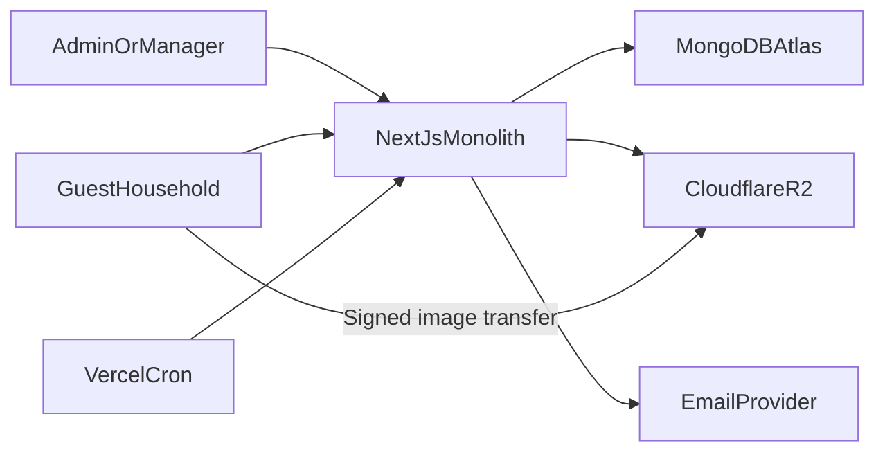
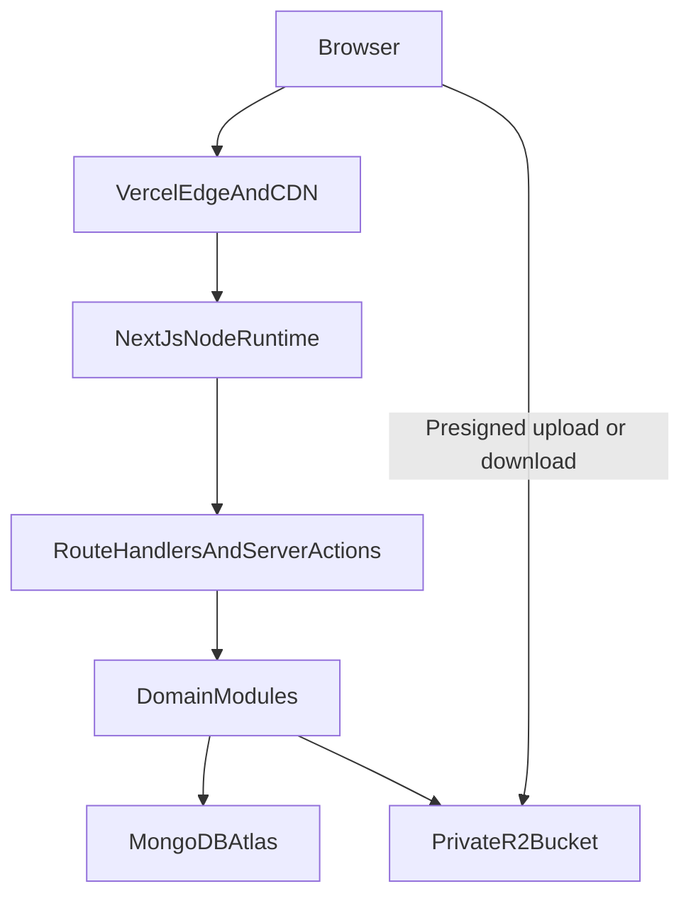
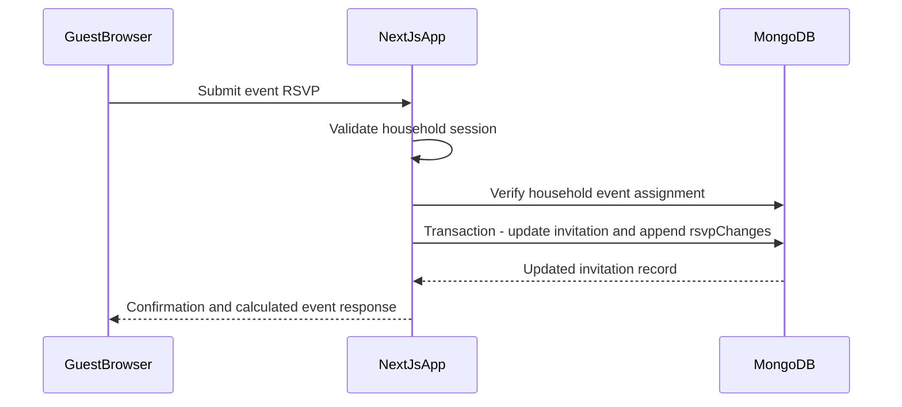
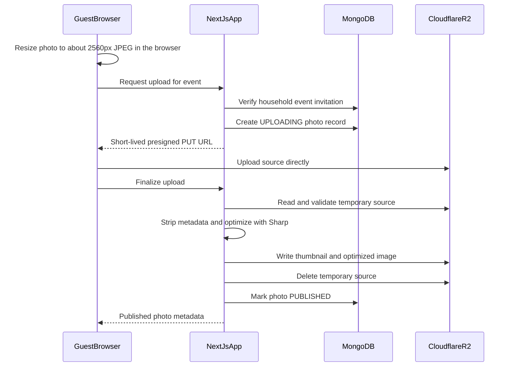
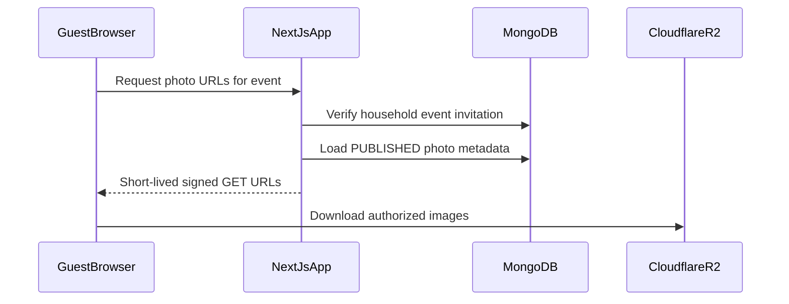

# Make My Marriage — System Design

## 1. Document status

- **Status:** Draft for architectural review
- **System:** Make My Marriage
- **Architecture style:** Modular monolith
- **Primary deployment target:** Vercel Hobby
- **Database:** MongoDB Atlas
- **Image storage:** Cloudflare R2
- **Target scale:** More than 1,000 guests and at least 10 wedding events

## 2. Important product alignment

This design uses an **event-private gallery**:

- A household may view, download, and upload photos only for events to which that household is invited.
- Guests cannot access albums belonging to other events.
- Admins and Managers can access all event albums.
- Photos are not publicly accessible without a valid household invitation or planner session.
- Album access depends only on the invitation, not on the household's RSVP answer.

`PRD.md` describes the same behavior. Field-level data design lives in `DATABASE_DESIGN.md` and endpoint contracts live in `API_DOCS.md`; where those documents are more specific, they take precedence.

## 3. Architectural goals

1. Keep development and deployment simple through one Next.js application.
2. Preserve clear module boundaries so the monolith remains maintainable.
3. Support event-level authorization for invitations, RSVPs, livestreams, and photos.
4. Keep large image transfers away from the application server.
5. Start on free managed services while retaining clear upgrade paths.
6. Protect private household and event information.
7. Remain reliable during invitation and wedding-day traffic spikes.

## 4. Constraints

- The first version is for one personal wedding.
- Delivery is targeted within three months.
- Guest invitations are distributed manually.
- Guests do not create accounts.
- Admins and Managers authenticate with email and password.
- Images are optimized and originals are not retained.
- Guest-uploaded videos are outside the MVP.
- Vercel Hobby has function, CPU, bandwidth, and cron limits.
- Vercel Function instances are ephemeral and cannot be treated as persistent servers.

## 5. System context



The Next.js application is the only application backend. MongoDB stores business records. R2 stores temporary uploads, thumbnails, and optimized images. An email provider is needed only for account recovery and operational email, not automated wedding invitations.

## 6. Deployment architecture



### 6.1 Vercel responsibilities

- Host the Next.js application.
- Serve static assets and cached public wedding information.
- Execute Node.js route handlers and server actions.
- Run the daily maintenance cron.
- Store environment variables.
- Build and deploy from the source repository.

### 6.2 MongoDB Atlas responsibilities

- Planner accounts and memberships.
- Wedding and event configuration.
- Households and private invitation-token hashes.
- Event assignments and RSVP responses.
- Tasks.
- Photo metadata and authorization relationships.
- Audit events.
- Expiring reset and rate-limit records where required.

### 6.3 Cloudflare R2 responsibilities

- Private temporary image uploads.
- Private event thumbnails.
- Private optimized event images.
- Direct signed upload and download.
- Object retention and deletion.

The R2 bucket remains private. Knowing an object key must not be sufficient to download an image.

## 7. Modular monolith structure

The application is one deployable unit with independent domain modules.

```text
src/
  app/
    (public)/
    (planner)/
    api/
  modules/
    auth/
    weddings/
    memberships/
    events/
    households/
    invitations/
    rsvps/
    tasks/
    photos/
    dashboard/
    audit/
  infrastructure/
    mongodb/
    storage/
    email/
    rate-limit/
    observability/
  shared/
    authorization/
    validation/
    errors/
    types/
```

Rules:

- UI routes do not query MongoDB directly.
- Domain modules own business rules and data access.
- Infrastructure implementations are accessed through small interfaces.
- Authorization is checked inside server-side use cases.
- Modules may reference identifiers from other modules but should not mutate another module's collections directly.

## 8. Runtime choices

- Use the Node.js runtime for routes that require MongoDB, password hashing, image processing, or R2 signing.
- Do not use Edge Runtime for Sharp or MongoDB operations.
- Use a cached MongoDB client per warm function instance.
- Do not store sessions, queues, or application state in process memory.
- Do not use the local filesystem for permanent files.
- Temporary function storage may be used only while processing one image and must not be relied upon after the request finishes.

## 9. Core data model

MongoDB collections are separated to avoid a single growing wedding document, reduce write contention, and support indexed reporting. This section summarizes the model; `DATABASE_DESIGN.md` is the authoritative field, index, and validation reference, including the `rsvpChanges` history collection.

### 9.1 `users`

Planner accounts only.

```text
_id
email
emailNormalized
passwordHash
displayName
status: ACTIVE | DISABLED
sessionVersion
createdAt
updatedAt
```

Indexes:

- Unique `emailNormalized`
- `status`

### 9.2 `weddings`

```text
_id
coupleNames
slug
story
welcomeMessage
city
startDate
endDate
contactInformation
coverImageKey
timezone
status: DRAFT | ACTIVE | ARCHIVED
createdAt
updatedAt
```

Indexes:

- Unique `slug`
- `status`

### 9.3 `memberships`

Connects planner users to a wedding.

```text
_id
weddingId
userId
role: ADMIN | MANAGER
status: ACTIVE | DISABLED
createdAt
updatedAt
```

Indexes:

- Unique compound index on `weddingId + userId`
- `userId + status`

### 9.4 `events`

```text
_id
weddingId
name
description
startAt
endAt
venueName
venueAddress
mapUrl
livestreamUrl
sortOrder
status: ACTIVE | ARCHIVED
createdAt
updatedAt
```

Indexes:

- `weddingId + status + sortOrder`
- `weddingId + startAt`

Dress-code and meal-choice fields are intentionally absent. The livestream URL is stored as plain text; it is protected by only returning it to households invited to the event.

### 9.5 `households`

```text
_id
weddingId
label
primaryContactName
email
phone
optionalMemberNames[]
internalNotes
tokenSalt
tokenHash
tokenRotatedAt
deliveryStatus: NOT_SENT | SENT
deliveryMarkedAt
status: ACTIVE | DISABLED
createdAt
updatedAt
```

Indexes:

- Unique `tokenHash`
- `weddingId + status`
- `weddingId + email`
- `weddingId + phone`
- Search-supporting normalized contact fields

The household token is derived, not stored: `token = HMAC-SHA256(INVITE_TOKEN_SECRET, householdId + ":" + tokenSalt)`, encoded as base64url. MongoDB stores the random `tokenSalt` and the SHA-256 `tokenHash` used for lookup.

- Planners can rebuild a household's link at any time, so the same link can be copied, shown as a QR code, or exported repeatedly without invalidating links already sent.
- A database leak alone does not reveal working links, because the secret lives only in the deployment environment.
- Regenerating a link means a new `tokenSalt`, which produces a new token and hash.
- `INVITE_TOKEN_SECRET` must never be rotated after invitations are sent, because that would invalidate every link at once.

### 9.6 `eventInvitations`

This collection represents both event assignment and the household's RSVP.

```text
_id
weddingId
eventId
householdId
response: PENDING | YES | NO | MAYBE
attendeeCount
optionalAttendeeNames[]
respondedAt
lastChangedBy
createdAt
updatedAt
```

Every change is also appended to `rsvpChanges` in the same transaction, which provides change history and the recent-cancellations view.

Indexes:

- Unique compound index on `eventId + householdId`
- `weddingId + eventId + response`
- `weddingId + householdId`
- `weddingId + updatedAt`

`attendeeCount` is unrestricted by product decision. Negative and non-integer values are rejected. Attendee names are optional. Dietary data is not collected.

### 9.7 `tasks`

```text
_id
weddingId
eventId: optional
title
description
assigneeUserId: optional
priority: LOW | MEDIUM | HIGH
status: TODO | IN_PROGRESS | DONE
dueAt: optional
completedAt: optional
createdByUserId
createdAt
updatedAt
```

Indexes:

- `weddingId + status + dueAt`
- `weddingId + assigneeUserId + status`
- `eventId + status`

### 9.8 `photos`

```text
_id
weddingId
eventId
uploadedByType: PLANNER | HOUSEHOLD
uploadedByUserId: optional
uploadedByHouseholdId: optional
status: UPLOADING | PROCESSING | PUBLISHED | HIDDEN | FAILED | DELETED
temporaryObjectKey: optional
thumbnailObjectKey: optional
optimizedObjectKey: optional
mimeType
width
height
optimizedSizeBytes
contentHash
failureCode: optional
createdAt
publishedAt: optional
deletedAt: optional
```

Indexes:

- `eventId + status + publishedAt`
- `weddingId + uploadedByHouseholdId`
- `weddingId + contentHash`
- `status + createdAt` for cleanup

The `contentHash` helps identify duplicate uploads but should not automatically delete a photo without confirmation.

### 9.9 `auditLogs`

```text
_id
weddingId
actorType: USER | HOUSEHOLD | SYSTEM
actorId
action
entityType
entityId
safeMetadata
createdAt
```

Indexes:

- `weddingId + createdAt`
- `entityType + entityId + createdAt`

Audit metadata must never contain passwords, raw invitation tokens, reset tokens, or signed storage URLs.

### 9.10 Expiring records

Password-reset tokens and rate-limit windows should use separate collections with TTL indexes where appropriate. MongoDB TTL deletion is eventually consistent and must not be treated as exact-to-the-second authorization expiry; application code must also verify expiry timestamps.

## 10. Authentication design

### 10.1 Planner authentication

- Admins and Managers sign in with email and password.
- Passwords are hashed with Argon2id or a comparably strong adaptive algorithm.
- Login responses do not reveal whether an email exists.
- Sessions use secure, HTTP-only, same-site cookies.
- Sensitive actions re-check that the user and membership are active.
- `sessionVersion` permits global session invalidation after password or security changes.
- Manager access can be disabled immediately by an Admin.

The exact authentication library remains an implementation decision. Auth.js is compatible with the chosen Next.js architecture, but the domain-level user and membership model must remain independent of the library.

### 10.2 Password recovery

Recommended design:

1. User requests recovery without receiving account-existence information.
2. Generate a random, single-use token.
3. Store only its hash and expiration.
4. Send the raw token in an HTTPS reset link.
5. On successful reset, mark the token used and increment `sessionVersion`.

The email provider is not yet selected. This provider is an infrastructure adapter and can be changed without altering authentication rules.

### 10.3 Household access

- The raw household token is carried in the private invitation URL or personalized QR code.
- The backend hashes the supplied token and finds the active household.
- Disabled households are rejected.
- Token regeneration replaces `tokenHash`, so the old URL no longer matches any household.
- The household session cookie stores a short fingerprint of `tokenHash`, so regeneration also ends existing guest sessions.
- The raw token is never written to application logs, analytics, audit records, or error reports.

For browser convenience, the verified household identity may be exchanged for a short-lived, secure household session cookie. This prevents repeatedly exposing the raw token in subsequent internal navigation while preserving the original invitation-link flow.

## 11. Authorization model

Authorization is deny-by-default.

### 11.1 Admin

- Full access to the wedding.
- Manage planner memberships.
- Access every event and album.
- Moderate every photo.
- Regenerate household links.
- Export wedding data.

### 11.2 Manager

- Manage operational wedding data.
- Access every event and album.
- Moderate every photo.
- Cannot manage Admin access or delete the wedding.

### 11.3 Household

A household may:

- View only assigned events.
- Read and update only its own RSVP records.
- View a livestream URL only for an assigned event.
- Request image URLs only for an assigned event.
- Upload photos only to an assigned event.
- Delete only photos uploaded by that household.

### 11.4 Authorization helper

Every household event action calls a shared server-side check equivalent to:

```text
authorizeHouseholdEvent(householdId, eventId, requiredAction)
```

This check verifies:

1. Household is active.
2. Event belongs to the same wedding.
3. An `eventInvitations` record exists for the household and event.
4. The requested action is allowed.

Client-side visibility is not an authorization control.

## 12. API design

All browser-facing operations are resource-oriented route handlers under `/api`, documented in `API_DOCS.md`. Planner screens call the same documented endpoints rather than undocumented server actions, so every operation has one contract and one authorization path.

Representative endpoints (see `API_DOCS.md` for the complete list):

```text
POST   /api/auth/login
POST   /api/auth/logout
POST   /api/auth/forgot-password
POST   /api/auth/reset-password

GET    /api/guest/session
GET    /api/guest/events
PATCH  /api/guest/events/{eventId}/rsvp

POST   /api/photos/upload-intents
POST   /api/photos/{photoId}/finalize
GET    /api/events/{eventId}/photos
POST   /api/photos/access-urls
DELETE /api/photos/{photoId}

POST   /api/admin/households/import
GET    /api/admin/reports/rsvps
GET    /api/internal/cron/maintenance
```

Requirements:

- Validate inputs with shared Zod schemas.
- Return stable error codes without leaking internals.
- RSVP saves replace the current answer, so repeating the same request is harmless. Upload finalization is safe to repeat because it checks the photo's current status.
- Apply request-size limits.
- Paginate list endpoints.
- Do not return storage object keys where a signed URL is sufficient.

## 13. RSVP write flow



Rules:

- One document represents one household's response to one event.
- The latest save wins. The response shows when it was last updated and by whom.
- The invitation update and its history entry are written in one transaction.
- A history entry is written only when the answer or count actually changes, so repeated identical saves add no history.
- Dashboard totals are computed from invitation records, with aggregation queries supported by indexes.
- If aggregate reporting becomes expensive, cached counters may be introduced later without changing the source of truth.

## 14. Image storage design

### 14.1 R2 object layout

```text
weddings/{weddingId}/
  temporary/{uploadIntentId}/source
  events/{eventId}/
    thumbnails/{photoId}.webp
    optimized/{photoId}.webp
```

Object names use generated identifiers, never guest-supplied filenames.

### 14.2 Upload-intent flow



### 14.3 Validation and processing

- The browser resizes each photo to roughly 2560 pixels on the long edge and re-encodes it as JPEG before upload. This cuts mobile upload time and server CPU, and converts iPhone HEIC photos, which the standard Sharp build generally cannot decode.
- The server never trusts the browser's resize: it still decodes, validates, and re-encodes every file.
- Maximum accepted upload size after resizing: 10 MB.
- Accept JPEG, PNG, and WebP on the server.
- Verify file signatures and decode the image before publication.
- Reject decompression bombs through pixel-dimension limits.
- Apply automatic orientation.
- Remove EXIF, GPS, comments, and unnecessary metadata.
- Generate a small WebP thumbnail.
- Generate a high-quality optimized WebP image suitable for display and download.
- Do not retain the source file after successful processing.
- Mark failures explicitly and clean temporary files later.

### 14.4 Download flow



- Generate signed URLs in batches for the visible page.
- Sign URLs against fixed one-hour windows rather than the current second. The same photo then gets the same URL for the rest of the window, so browsers can cache thumbnails instead of downloading them again on every visit.
- Never expose permanent public R2 URLs.
- Signed URLs grant read access only and cannot delete objects.
- Pagination limits the number of signatures and records created per request.

### 14.5 Photo deletion

- Household deletion requires matching `uploadedByHouseholdId`.
- Admin and Manager deletion requires an active membership.
- Delete or hide the MongoDB record first according to the moderation action.
- Remove R2 objects asynchronously or during the same request when reliable.
- A retryable cleanup process handles orphaned objects.
- Other guests never receive delete authorization.

## 15. Image-processing reliability

Vercel image processing is the main free-tier risk.

- Process one image per invocation.
- Keep processing idempotent.
- Use deterministic destination keys.
- If finalization is called twice, return the existing published result.
- If processing fails, retain a failure status and delete or retry the temporary source.
- Do not publish a photo until all required derivatives exist.
- Daily maintenance removes stale `UPLOADING`, `FAILED`, and orphaned temporary objects.
- Monitor Vercel CPU usage and R2 storage.

Upgrade path if CPU limits are exceeded:

1. Keep the same MongoDB records and R2 object layout.
2. Move only the image-processing adapter to a managed worker or paid compute service.
3. Preserve the Next.js monolith as the control plane.

This avoids redesigning guest, authorization, or gallery behavior.

## 16. Cron design

Vercel Hobby cron may run each configured job at most once daily and with hour-level timing precision.

Use one secured daily maintenance endpoint to:

- Expire abandoned uploads, meaning photo records still in `UPLOADING` after 24 hours.
- Delete stale temporary R2 objects.
- Retry safe object cleanup.
- Mark unrecoverable processing records failed.
- Remove R2 files for photos marked `DELETED` and set `purgedAt`.
- Export the wedding's core collections as JSON to a private R2 backup prefix, keeping the last seven exports. This is the free backup while the database is on the free tier.
- Remove expired application records not already handled by TTL indexes.

Security:

- Require a secret authorization value configured in the deployment environment.
- Reject normal browser requests.
- Make every cleanup operation idempotent.
- Process bounded batches so the function remains within runtime limits.
- Continue from the last cursor on the next daily run.

Cron must not be used for immediate photo publication, RSVP writes, or security-critical expiry.

## 17. Caching strategy

### 17.1 Cacheable

- Public wedding landing-page content that contains no private event information.
- Static application assets.
- Non-sensitive event-independent artwork.

### 17.2 Not publicly cacheable

- Household invitation pages.
- RSVP records.
- Event assignments.
- Livestream links.
- Photo metadata for event-private albums.
- Signed R2 URLs.
- Planner dashboard responses.

Private responses use appropriate `Cache-Control` headers such as `private` or `no-store`.

R2 may cache object bytes internally, but access remains controlled by expiring signed URLs.

## 18. Rate limiting

Rate limits are required for:

- Planner login.
- Password-reset requests.
- Household-token verification.
- RSVP mutations.
- Upload-intent creation.
- Upload finalization.
- Signed image URL generation.
- Photo deletion.

General traffic limits use Vercel firewall rules, which cost no database operations. MongoDB counters with TTL expiration are used only for planner login, password reset, household-link verification, and photo uploads, because the free database tier allows only about 100 operations per second. The rate-limit module exposes an interface so it can later move to managed Redis without changing route logic.

Limits should combine:

- IP address or privacy-preserving IP hash.
- User or household identity when available.
- Action type.
- Short and longer time windows.

Rate limiting supplements authorization and does not replace it.

## 19. Security design

### 19.1 Primary threats

- Guessing or leaking household invitation links.
- Accessing photos from uninvited events.
- Uploading disguised or malicious files.
- Deleting another household's photos.
- Brute-forcing planner credentials.
- RSVP manipulation.
- Leaking livestream URLs.
- Exposing secrets or personal information in logs.

### 19.2 Controls

- High-entropy invitation tokens stored only as hashes.
- Server-side event authorization for every private action.
- Private R2 bucket and short-lived signed URLs.
- File signature validation and safe image decoding.
- Upload-size, dimension, and rate limits.
- Secure cookies and CSRF-safe mutation handling.
- Password hashing and login throttling.
- Input validation and output encoding.
- Security headers including a restrictive Content Security Policy.
- Secret redaction in logs and monitoring.
- Audit logs for privileged and destructive actions.
- Token regeneration after suspected exposure.

### 19.3 Data minimization

- Do not collect dietary information.
- Attendee names remain optional.
- Do not collect more guest information than operationally necessary.
- Do not place contact details in R2 object metadata or keys.
- Define a post-wedding retention and deletion policy before launch.

## 20. MongoDB connectivity

- Use one shared client promise per function instance.
- Configure connection and server-selection timeouts.
- Use a dedicated least-privilege production database user.
- Keep development and production databases separate.
- Require TLS.
- Store credentials only in environment variables.

The free tier allows 512 MB of storage, about 100 operations per second, and 500 connections. Opening a guest invitation costs about four operations; the non-private event list may be cached in each server instance for one minute to reduce that during wedding-day peaks.

Vercel Hobby does not provide fixed outbound IP addresses. Atlas network configuration may therefore require broad network reachability protected by strong database credentials and TLS. If strict IP allowlisting becomes mandatory, deployment must move to infrastructure with stable egress or an appropriate paid networking option.

## 21. Imports, exports, and guest-facing material

### 21.1 Guest import

- Upload CSV or Excel through a protected planner route.
- Parse within explicit row and file-size limits.
- Validate all rows before final import.
- Show duplicate candidates and invalid rows.
- Commit confirmed rows in bounded batches.
- Record who performed the import.
- Do not execute spreadsheet formulas.

Imports run in two requests: a preview that validates every row and reports duplicates without saving, then a commit of the confirmed rows. Two thousand rows fit comfortably in one request, so no resumable import jobs are stored.

### 21.2 Exports

- Generate CSV reports from indexed queries.
- Stream output when possible.
- Exclude raw invitation tokens by default.
- Allow private-link exports only to Admins through an explicit action.
- Record sensitive exports in the audit log.

### 21.3 Invitation cards, QR codes, and the sending sheet

- Invitation cards and QR codes are generated in the planner's browser from data returned by the API, so they cost no server CPU.
- Private links are rebuilt on the server from the household's `tokenSalt` and the deployment secret, so the same link is returned every time until it is deliberately regenerated.
- The sending sheet is a CSV with household label, contact name, phone number, private link, and a `https://wa.me/` link containing the prefilled message. Family members can split the rows and send them by hand.

### 21.4 Public wedding page

- Served at `/w/{slug}` with the couple's names, story, dates, city, and contact details.
- Contains no event assignments, guest names, livestream links, or photos.
- Cached at the CDN and refreshed when an Admin edits the wedding details.

## 22. Observability

Minimum production visibility:

- Structured application logs with request or correlation identifiers.
- Error monitoring for client and server failures.
- Upload failure counts.
- RSVP mutation failure counts.
- Authentication and rate-limit alerts.
- Vercel function CPU and invocation usage.
- MongoDB connection, query, and storage usage.
- R2 storage and operation usage.
- Daily maintenance results.

Logs must exclude raw household tokens, passwords, reset tokens, signed URLs, and unnecessary personal data.

An external error-monitoring provider is recommended because Vercel Hobby log retention is limited. The provider remains to be selected.

## 23. Backup and recovery

### 23.1 MongoDB

- On the free tier, rely on the daily JSON export to R2 described in the cron design. If budget allows later, enable Atlas free-cluster backups (about $3 a month) or move to a paid tier.
- Take an additional verified export before mass invitation distribution.
- Take another export before major guest imports or destructive migrations.
- Test restoration before launch.

### 23.2 R2

- Treat accidental deletion and logical corruption separately from infrastructure durability.
- Prefer soft deletion in MongoDB before physical object deletion.
- Consider an object-retention window if supported within the selected cost constraints.
- Maintain tools to identify MongoDB records without objects and objects without records.

### 23.3 Recovery objectives

Before launch, define:

- Maximum acceptable data loss.
- Maximum acceptable recovery time.
- Who is responsible for restoring the application.
- How guests will be informed during an outage.

## 24. Environment strategy

Use separate environments:

- Local development
- Vercel preview
- Production

Each environment has:

- Separate MongoDB database or cluster.
- Separate R2 bucket or isolated object prefix.
- Separate authentication secrets.
- Separate household-token hashing context.
- Environment-specific application URLs.

Production data must not be copied into preview deployments.

## 25. Free-tier capacity and upgrade triggers

The system starts with:

- Vercel Hobby for application hosting.
- MongoDB Atlas managed cluster.
- Cloudflare R2 free allowance for images.

Upgrade or mitigation is triggered by:

- Vercel CPU exhaustion from image processing.
- Function timeout or memory failures.
- R2 storage exceeding the free allowance.
- MongoDB storage or connection pressure.
- Need for fixed outbound IP addresses.
- Need for more precise or frequent scheduled jobs.
- Insufficient logging, monitoring, or backups.

The application must degrade safely. It is preferable to temporarily pause new uploads while preserving invitations and RSVPs than to make the entire application unavailable.

## 26. Performance strategy

- Paginate households, invitations, tasks, and photos.
- Use compound indexes that match dashboard and report filters.
- Select only required MongoDB fields.
- Avoid loading all household or photo records into memory.
- Serve image bytes directly from R2.
- Use thumbnails in gallery grids.
- Batch signed URL generation for the visible page.
- Debounce planner search.
- Cache only non-private wedding content.
- Load dashboard cards independently where practical so one expensive report does not block the entire page.

## 27. Accessibility and mobile behavior

- Guest invitation, RSVP, livestream, and gallery flows are mobile-first.
- Upload supports phone photo pickers.
- Upload progress and retry states are visible.
- Forms remain usable with keyboard and assistive technology.
- Color is not the only indicator of RSVP or task status.
- Dates and times use the configured wedding timezone.
- Venue addresses provide a safe external map action.

## 28. Testing strategy

### 28.1 Unit tests

- Authorization policies.
- RSVP validation and headcount logic.
- Token hashing and regeneration.
- Task state changes.
- Photo ownership and deletion rules.
- Import validation.

### 28.2 Integration tests

- MongoDB repositories and indexes.
- Planner authentication and role enforcement.
- Household invitation exchange.
- Event-specific photo authorization.
- R2 signed upload and download flows.
- Image validation and optimization.
- Cron cleanup idempotency.

### 28.3 End-to-end tests

1. Admin creates events and a Manager.
2. Manager imports households.
3. Household A is invited to Event A only.
4. Household B is invited to Event B only.
5. Household A cannot access Event B, its livestream, or its photos.
6. Household A submits and updates an RSVP for Event A.
7. Household A uploads and downloads an Event A photo.
8. Household B cannot delete Household A's photo.
9. Manager hides or deletes the photo.
10. Expired and regenerated household links fail safely.

### 28.4 Load and resilience tests

- Concurrent invitation-page requests.
- RSVP submissions from many households.
- Gallery pagination with thousands of photos.
- Concurrent direct uploads.
- MongoDB connection reuse under serverless scaling.
- Partial R2 and MongoDB failures.
- Repeated finalization and delete requests.

## 29. Delivery sequence

1. Establish the modular Next.js skeleton and environment validation.
2. Implement MongoDB connection management and core collections.
3. Implement planner authentication and memberships.
4. Implement wedding and event management.
5. Implement households, token access, and event invitations.
6. Implement RSVP and dashboard reporting.
7. Implement task management.
8. Implement R2 upload intents and image processing.
9. Implement event-private gallery authorization.
10. Implement daily maintenance and cleanup.
11. Add imports, exports, monitoring, and audit records.
12. Test with a small pilot group before full invitation distribution.

## 30. Architecture decisions

### Accepted

- Modular monolith.
- One Next.js application using the Node.js runtime.
- MongoDB Atlas for application data.
- Cloudflare R2 for image files.
- Images are not stored in MongoDB.
- Optimized downloads only; original camera files are deleted.
- Event-private galleries.
- Email/password for Admin and Manager authentication.
- Private token links for household access.
- Direct signed image transfer.
- Daily cron only for maintenance and backups.
- Mongoose for persistence and Zod for request validation.
- RSVP change history in a separate `rsvpChanges` collection.
- Photos resized in the browser before upload.
- Last-save-wins RSVPs instead of revision checks.
- Livestream URLs stored as plain text and protected by authorization.
- No bride/groom side tag on households.

### Recommended but requiring final implementation selection

- Auth.js or equivalent for planner sessions.
- Argon2id password hashing.
- Sharp for image validation and optimization.
- Vercel firewall rules plus MongoDB-backed limits for sensitive actions.
- External error monitoring.
- Email provider for password recovery.

### Open decisions

- Password-recovery provider and final behavior.
- Whether a small monthly budget is available around the wedding.
- Exact Vercel production plan policy if Hobby limits are reached.
- Exact Atlas cluster tier and backup capability.
- Custom domain.
- Image dimensions, WebP quality, and final upload-size limit.
- Error-monitoring provider.
- Data-retention period after the wedding.

## 31. References

- [Vercel Hobby plan](https://vercel.com/docs/plans/hobby)
- [Vercel Function limits](https://vercel.com/docs/functions/limitations)
- [Vercel Cron usage and limits](https://vercel.com/docs/cron-jobs/usage-and-pricing)
- [Cloudflare R2 pricing](https://developers.cloudflare.com/r2/pricing/)
- [Cloudflare R2 presigned URLs](https://developers.cloudflare.com/r2/api/s3/presigned-urls/)
- [MongoDB Atlas documentation](https://www.mongodb.com/docs/atlas/)
